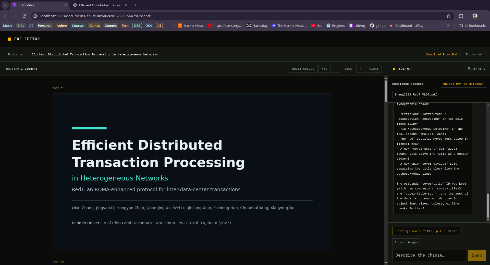
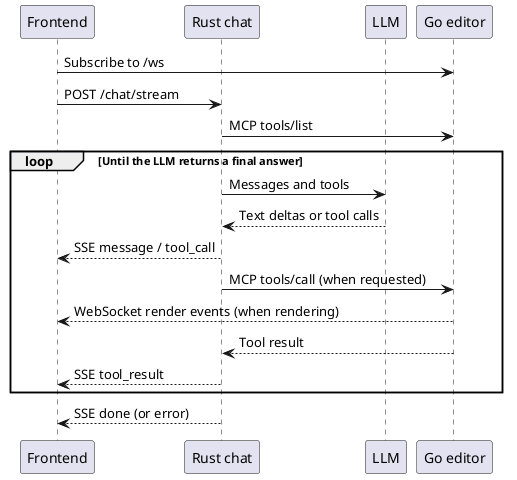
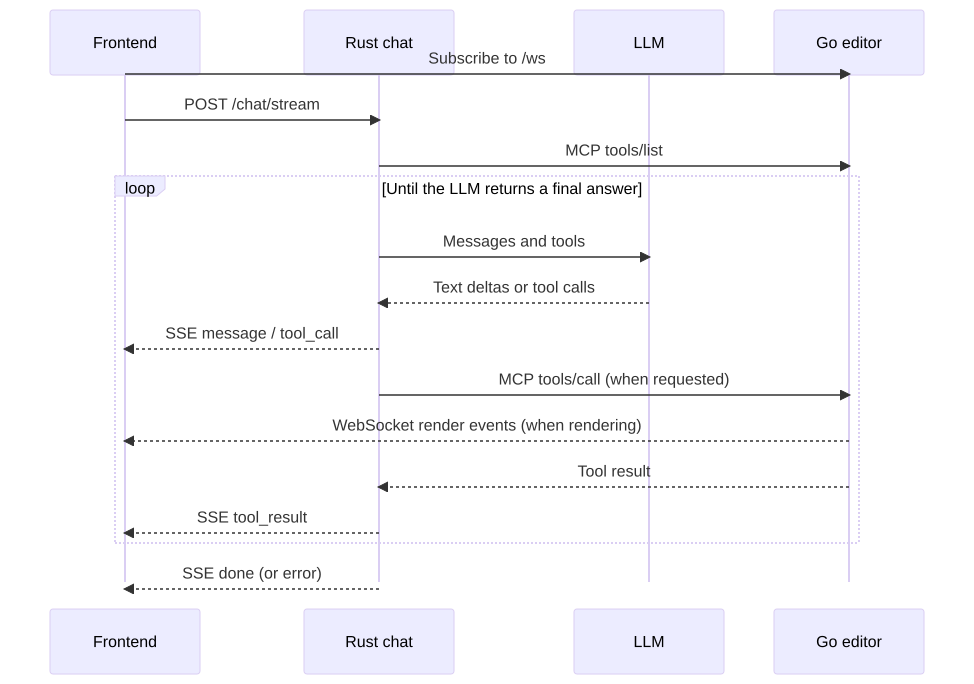

# Chat-edited PDF and slideshow Back-End

This is a project to test LLM harness using rust and a main server in golang. The idea is to ask AI to edit PDFs and slides. We will run our own Chat Loop and give AI tools via MCP calls on the main editor backend.

Tools:
- `get_script`, `get_element`, `list_elements`: inspect the script and selected elements.
- `edit_script`, `render`: save edits and render a new version.
- `editing_pdf`: notify the frontend that editing started.
- `add_svg`: store an SVG asset.
- `list_versions`, `restore_version`: inspect and restore versions.
- `list_sources`, `get_source`: read uploaded references.

Rust fetches tool schemas through MCP `tools/list` at the Go server's `/mcp` endpoint. LLM tool calls become MCP `tools/call` requests with the tool name and JSON arguments.

<!--
[Mermaid source](docs/chat-flow.mmd)

-->

The frontend sends a message, document ID, and optional selections or images. Rust adds document context and available chat history, then runs the LLM loop. Tool results feed back into the next LLM request until it answers.

`POST /chat` returns a JSON reply. `POST /chat/stream` streams text and tool activity through SSE. Separately, Go sends render updates through `/ws`; the frontend reloads the PDF after `pdf_updated`.

Setup and implementation details: [How it works](how_works.md).
