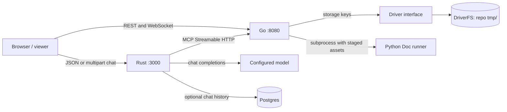

# Backend architecture

This page describes the current code. [PLAN.md](PLAN.md) preserves the earlier design proposal.



## Storage

`DriverFS` implements a key-based `Driver` interface with get, put, put-if-absent, list, and delete operations. Go's document store, template catalog, PDF handler, source uploads, image uploads, and SVG tool use the driver. The service does not require local filesystem paths, leaving room for an S3 or GCP driver using the same keys. Only `DriverFS` exists today.

The default driver root is this repo's Git-ignored `tmp/` directory:

```text
tmp/
  templates/{template_id}/template.json
  templates/{template_id}/cover.png
  pdf/{doc_id}/
    project.json
    {asset_name}.{svg,png,jpg}
    sources/{source_id}.md
    sources/{source_id}.json
    versions/{version}/
      script.py
      manifest.json
      pdf_render.pdf
      cover.png
      assets/{asset_name}.{svg,png,jpg}
```

`project.json` holds the draft, project metadata, and the version index. On render, Go stages project SVGs and raster images in Python's temporary working directory, then saves a snapshot under the version. A missing historical PDF rebuilds with that version's script and asset snapshot. There is no separate current-PDF copy. `PDF_DATA_DIR` or `-data-dir` changes the driver root. Clearing `tmp/` deletes projects; there is no migration from the former Postgres document store. Rust chat history remains optional Postgres data.

## Lifecycle

1. Startup seeds `empty`, `report`, `slideshow`, `business`, and `metrics` template files only when missing, and generates missing first-page covers. No demo projects are seeded. Template files have no editing API. The two new presentation templates each render four 16:9 slides.
2. `POST /docs` copies a stored template into a new project and renders version 1. A failed initial render removes the incomplete project.
3. `edit_script` saves a draft when `base_version` matches the current version. `render` commits the draft as a new version, executes Python, stores the PDF, first-page PNG cover, and manifest, then broadcasts `pdf_updated`. A failed later render leaves a version without output and broadcasts `pdf_failed`.
4. `restore_version` copies an older script into the draft; a later render makes a new version. `add_svg` writes an editable SVG at the project root. Rendering snapshots it for rebuilds.
5. The browser reads PDF and manifest URLs from project metadata and watches `/ws`. Events are hints: the browser refetches after an update or reconnect.

The manifest maps stable element IDs to page, bounding box, type, and source line. Coordinates are PDF points from the bottom-left corner. A split element has several entries under one ID.

## Limits

Python executes model-written code as a local subprocess with a timeout and reduced environment; it is not isolated for public untrusted use. REST has optional shared-token auth, while MCP, chat, and WebSocket lack per-user auth. The Go store uses an in-process lock and atomic file replacement, so one Go instance should own a data root. Rust streams message and tool events through `POST /chat/stream`; `POST /chat` retains its JSON response.

## Runtime configuration

BUILD run commands load their own project’s `.env` dependency with Bash automatic export, then start the service. Each target declares host variables in `pass_env`; `.env` assignments take precedence. Go and Rust read environment variables only, without searching the filesystem. Runtime targets are uncached and binary build targets do not consume `.env`. The renderer receives Go's reduced environment, without model credentials. Configuration is scoped to each project: `server/.env` holds Go settings, `chat/.env` (or `chat/.env.claude`) holds chat settings and model credentials, and `gen/.env` holds Python setup settings. Server and generator configure their Python paths independently. See README and each project’s `.env.example` for variable names and local setup.

## Sources and chat uploads

Go accepts PDF and Markdown source uploads through REST and stores Markdown through the same Driver as other project data. Poppler `pdftotext` converts text PDFs; there is no OCR. MCP `list_sources` and `get_source` expose references to the model. Source text is data, not instructions.

Rust accepts JSON or multipart chat requests. Multipart PNG/JPEG attachments are forwarded to Go before the model loop begins. Go stores images at the project root; the model receives asset names for `Doc.image`. Every successful render snapshots SVG and raster assets for historical rebuilds. Chat persists selection context and attachment references in the user message. PostgreSQL remains the chat history store; the history endpoint reports unavailable persistence explicitly.

## Slideshow rendering

Projects persist a `type` of `pdf` or `slideshow`; legacy records default to `pdf`. PDF scripts use ReportLab `Doc`. Slideshow scripts use the `Slides` wrapper over python-pptx, which records shape IDs, slide numbers, source lines, and PDF-coordinate bounding boxes. The runner converts the deck using headless LibreOffice with an isolated temporary profile, then creates the first-page cover with Poppler.

Every slideshow version stores `slides.pptx` beside `pdf_render.pdf`, `manifest.json`, and `cover.png`. Saved scripts and asset snapshots rebuild either format without changing the version. Template seeding adds separate native slideshow templates; it does not rewrite existing PDF templates or project scripts. The chat prompt reads `get_script.type` before editing to select the matching Python API.

Before starting Go, `//server:run` runs `//server:renderer`. This uncached setup reads `server/.env`, installs the pinned renderer requirements into `PDF_PYTHON`, and verifies imports. The generator’s separate `//gen:venv` target continues to use `gen/.env`; its environment does not select the server interpreter.
